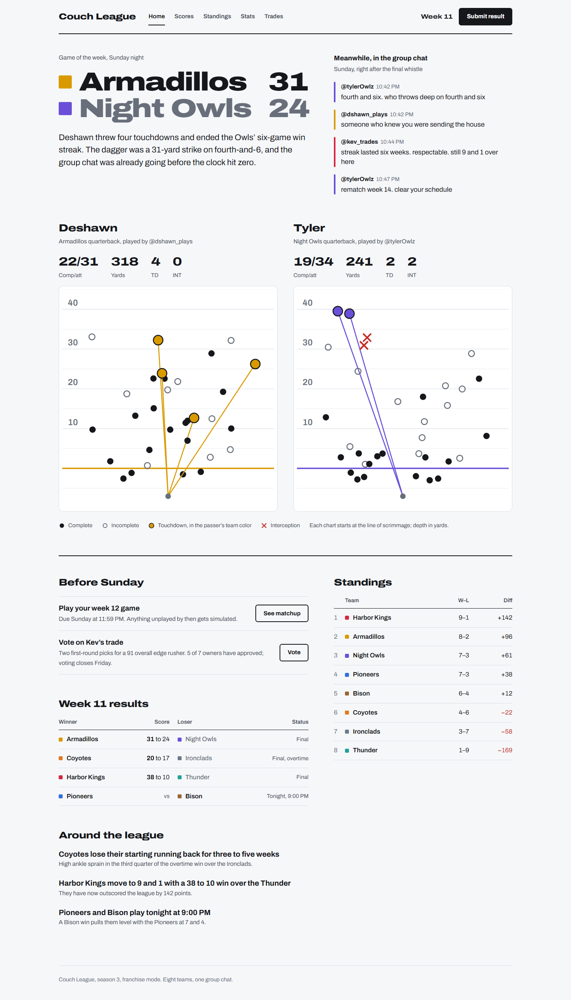
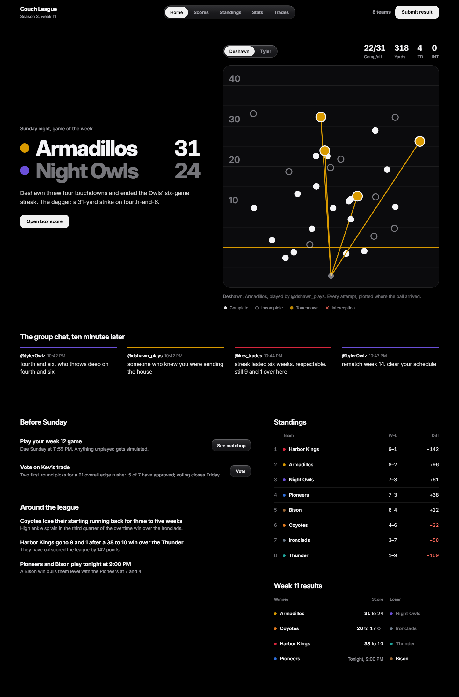

# Saintz Skills

Two [Claude Code](https://claude.com/claude-code) skills for designing user interfaces that look intentional and polished instead of generic.

| Skill | What it does |
|---|---|
| [`saintz-design`](skills/saintz-design/SKILL.md) | My house **look**: a dark, monochrome "liquid glass" style with frosted controls, white for the selected state, and springy motion. It includes exact colors, type scale, radii, glass recipes, component conventions and animation curves, plus a copy-paste [`tokens.css`](skills/saintz-design/references/tokens.css). |
| [`saintz-frontend`](skills/saintz-frontend/SKILL.md) | The **process and quality bar**, with required steps: write the brief and the product's *angle*, ban the category's obvious choices, plan, build, then run a [slop scan](skills/saintz-frontend/scripts/slop-check.mjs) and review screenshots. It covers layout, spacing, typography, color, component states, motion, interface copy and accessibility, plus a [layout & spacing reference](skills/saintz-frontend/references/layout-spacing.md) that includes what to use instead of cards. |

## Why they work together

They answer two different questions:

- **`saintz-frontend` answers *how* to design.** It works for any project and any brand: it makes Claude understand what's being built, plan a small token system, align everything to a grid and a spacing scale, design every state, write clear copy, and check the result at every screen size. It deliberately avoids the default looks that make generated pages feel templated.
- **`saintz-design` answers *what it should look like*** when the project is one of mine or when you want this particular style. It's a finished visual language, so there's no need to invent a new palette or type scale each time.

When both load, `saintz-design` supplies the look and `saintz-frontend` still runs every required step on it. The house style gets no exemptions from the budgets: a good material (glass) doesn't stop a page from being generic if every section is boxed, every heading has a little label, and a stock glow fills the corner. For any other brand or brief, `saintz-frontend` picks the look from the subject instead. Your own instructions always override both.

## Why the hard steps exist

A list of "don't do this" isn't enough. Left alone, a model drifts back to the statistically likely design: a dark background with one bright accent, everything in rounded cards, `A · B · C` meta lines, and the category's stock look (turf green and condensed type for sports, navy for finance, neon for dev tools). So `saintz-frontend` makes Claude write down the product's angle and the obvious choices it's ruling out, and it ships with a checker:

```bash
node ~/.claude/skills/saintz-frontend/scripts/slop-check.mjs path/to/your/ui
```

A second script takes full-page screenshots at true phone, tablet and desktop widths (using your installed Chrome or Edge) and flags horizontal overflow:

```bash
node ~/.claude/skills/saintz-frontend/scripts/shoot.mjs path/to/page.html --widths 375,768,1440 --out shots
```

Both need Node 22+ and have no dependencies. The slop scan reports **FAIL** (fix it) and **WARN** (fix it or justify it) for template chrome, decorative gradients, card-kit patterns, accent overuse, text under 12px, filler copy, missing reduced-motion support, missing focus styles, and more. It exits with code 1 if anything fails, so you can also use it in CI.

## Example

[`examples/couch-league`](examples/couch-league) is the same brief (a home page for a private 8-team franchise league) built twice by following the skills: once with `saintz-frontend` alone, and once with both skills. Both pass the slop scan and were checked at 375, 768 and 1440px.

| `saintz-frontend` only | `saintz-design` + `saintz-frontend` |
|---|---|
|  |  |

## Install

Copy the folders from `skills/` into your Claude Code skills directory:

- **Personal (all projects):** `~/.claude/skills/` (Windows: `%USERPROFILE%\.claude\skills\`)
- **One project only:** `<project>/.claude/skills/`

```bash
git clone https://github.com/saintzdid12/saintz-skills.git
cp -r saintz-skills/skills/* ~/.claude/skills/
```

Claude Code picks them up automatically. They load whenever you ask for UI work: building or restyling a page, app, component, dashboard or mockup, or asking for something to look better, cleaner or less generic. You can also call one directly by name, e.g. `/saintz-frontend`.

Want only the process without my look? Install just `saintz-frontend`.

## Credits

`saintz-frontend` is inspired by Anthropic's `frontend-design` skill and expands on its ideas. `saintz-design` is distilled from the interfaces of my own apps.

## License

[MIT](LICENSE)
